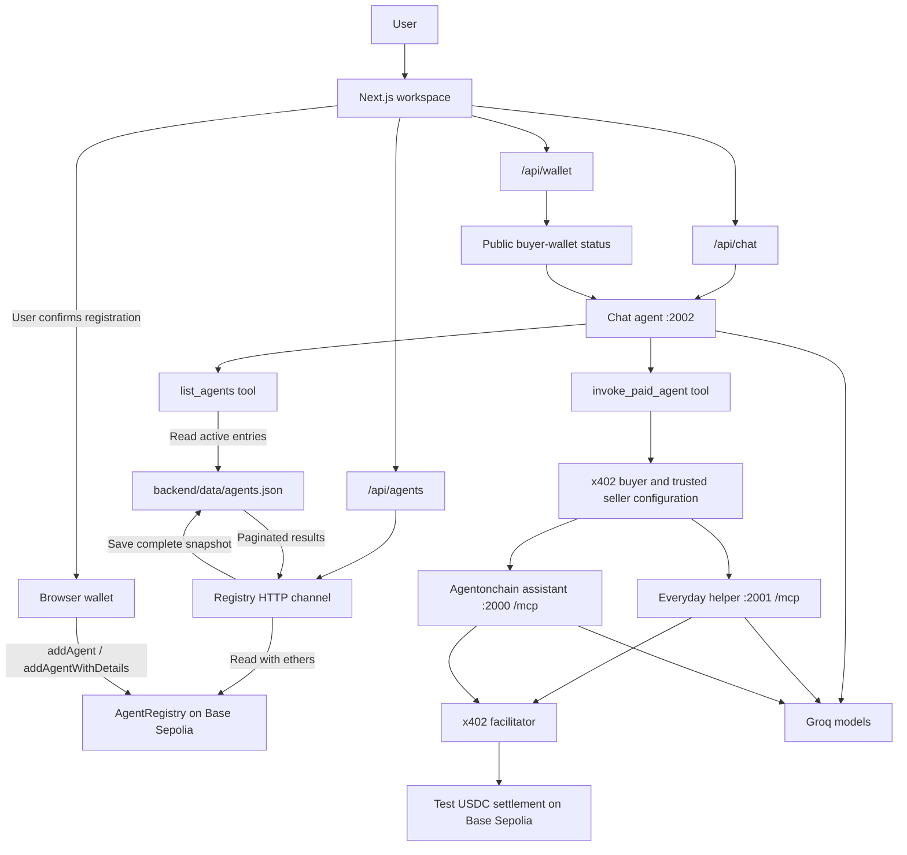
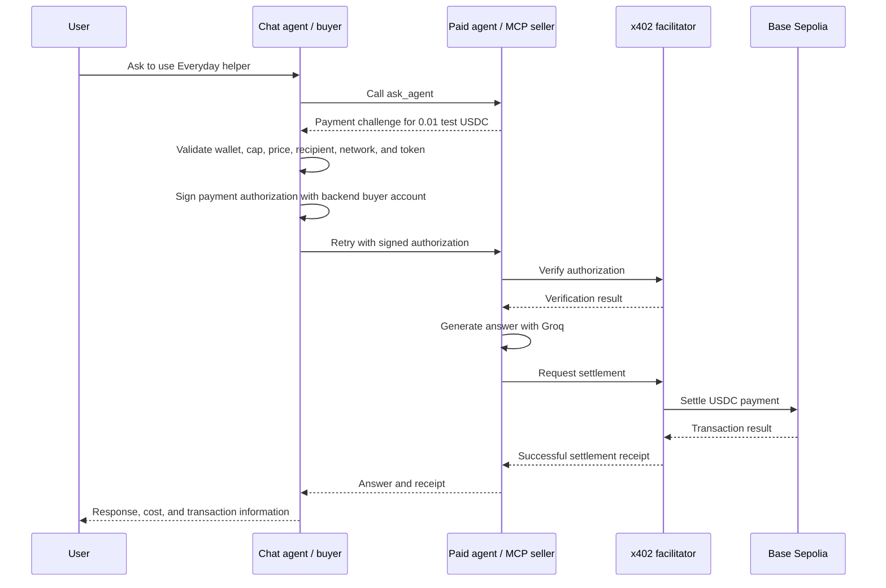

# Agentonchain

## Project overview

Agentonchain is a local prototype for discovering AI agents, registering their services on-chain, and paying them to answer questions. A user interacts with one conversational agent, which can call another agent and pay for its response within a configured spending limit.

The project connects three workflows:

- **Chat:** Talk to a free conversational agent, discover available agents, or ask it to use a selected paid agent.
- **Deploy:** Register an existing agent's name, payment wallet, description, and endpoint in a Solidity contract. Browse the registered agents and refresh their details from the blockchain.
- **Cards:** Set the public buyer-wallet address and maximum USDC amount that Chat agent may spend per call.

All agents use Groq for model responses. The backend services run locally, while registration and test-USDC settlement happen on **Base Sepolia**.

For example, a user can ask:

> Use Everyday helper to explain what an API is.

Chat agent sends the question to Everyday helper through its paid MCP endpoint. The buyer authorizes a payment of **0.01 test USDC**, the seller generates an answer, and a facilitator settles the payment before the answer is released. Chat agent then returns the answer and payment receipt to the user.

The **Deploy agent** action registers an already running service. Starting or hosting that service remains a separate step.

## Tech stack

| Layer | Technology | Role |
| --- | --- | --- |
| Web application | Next.js 16, React 19, TypeScript | Workspace UI and server-side API proxies |
| Styling | CSS Modules, global CSS, CSS variables | Agent cards, registration form, chat, and wallet views |
| Response rendering | React Markdown, remark-gfm | Markdown replies, tables, and other formatted agent output |
| Agent runtime | Eve | Independent agent services, sessions, tools, and event streams |
| Model provider | Groq through `@ai-sdk/groq` | Generates responses; defaults to `openai/gpt-oss-20b` |
| Agent communication | Model Context Protocol (MCP) | Tool discovery and calls to paid agents over HTTP |
| Agent payments | `@x402/core`, `@x402/evm`, `@x402/mcp` | Payment challenges, authorization, verification, and settlement |
| Backend signing | viem | Signs USDC payment authorizations with the configured buyer account |
| Contract interaction | ethers v6 | Reads registry data and prepares browser-wallet registration transactions |
| Smart contract | Solidity `AgentRegistry` | Stores agent registrations and owner-controlled updates |
| Blockchain | Base Sepolia | Test network for registry transactions and test-USDC payments |
| Local storage | JSON files and Eve runtime storage | Shared directory snapshot, sessions, and paid-call records |
| Runtime and tooling | Node.js 24+, Bun, TypeScript, ESLint | Runs services, manages dependencies, and validates the code |

The current design uses local files for the directory and payment ledger rather than an application database.

## Architecture

### System layout



The application has three main layers: the browser workspace, the local agent backend, and blockchain services. The browser handles interaction and wallet confirmation. The backend handles model sessions, directory synchronization, and paid-agent calls. Base Sepolia stores registry entries and records settled payments.

### 1. Frontend workspace

The frontend provides a demo login followed by **Chat**, **Deploy**, and **Cards** views.

| API route | Destination | Purpose |
| --- | --- | --- |
| `/api/chat` | Chat agent's Eve session API | Creates or continues a session and streams replies to the browser as NDJSON |
| `/api/agents` | Chat agent's `/registry/agents` channel | Refreshes and reads the on-chain agent directory |
| `/api/wallet` | Chat agent's `/payments/wallet` channel | Returns public backend signer information |

The chat interface retains an Eve session ID and stream cursor for follow-up messages. Browser login state, displayed messages, and the saved payment card are held in React state and clear on reload or sign-out.

### 2. Agent services

Three Eve services run independently:

| Agent | Local endpoint | Responsibilities | Price |
| --- | --- | --- | --- |
| Chat agent | `http://127.0.0.1:2002/eve/v1/session` | Answers ordinary questions, lists directory entries, and invokes a selected trusted seller | Free |
| Everyday helper | `http://127.0.0.1:2001/mcp` | Practical answers and step-by-step guidance | 0.01 test USDC per `ask_agent` call |
| Agentonchain assistant | `http://127.0.0.1:2000/mcp` | General questions, explanations, and examples | 0.01 test USDC per `ask_agent` call |

Chat agent has two tools: `list_agents` and `invoke_paid_agent`. The seller agents have no model tools and answer from their instructions and model knowledge. Each paid query starts a fresh seller task.

### 3. Registration and discovery

`solidity/AgentRegistry.sol` stores each agent's name, payment wallet, entry owner, description, endpoint URL, and active status. Anyone can register an entry. Only its owner can update its details or change its active status.

Registration follows this path:

1. The user opens **Deploy agent** and enters the agent details.
2. The app presents a review step before requesting a browser-wallet transaction.
3. A basic entry calls `addAgent(name, wallet)`. An entry with a description or endpoint calls `addAgentWithDetails(name, wallet, description, endpointUrl)`.
4. The app checks for a successful receipt containing the contract's `AgentAdded` event.
5. After confirmation, it refreshes the directory and shared JSON snapshot.

Opening Deploy or clicking **Refresh agents** makes the backend read every registry page at one block number. The backend then atomically replaces `backend/data/agents.json` with the complete result, including inactive entries and the contract address, chain, block number, and refresh time.

Deploy displays pages of 24 entries from that snapshot. Chat agent's `list_agents` tool reads the same file on each call and returns entries marked active. A failed refresh keeps the previous file; a successful empty refresh clears old entries. The generated JSON file is ignored by Git.

**Discovery and payment authorization are separate.** The public directory can contain any registration, but `invoke_paid_agent` currently accepts only the configured `everyday-helper` and `agentonchain-assistant` seller IDs. Adding an entry on-chain does not authorize payments to arbitrary wallets or calls to arbitrary endpoints.

### 4. Agent-to-agent payment flow

The paid services expose an MCP tool named `ask_agent`. x402 adds payment requirements to that tool call.



The backend enforces the lower of the user's saved card limit and `X402_MAX_PER_CALL_USDC`. It validates the fixed price, configured seller recipient, Base Sepolia network, test-USDC contract, payment scheme, and authorization timeout before signing.

Verification happens before model execution. Successful settlement is required before releasing the answer. Agent-generation failures are not settled, and uncertain payment outcomes are not automatically retried.

A local ledger under `backend/chat-agent/.eve/paid-calls/` reserves one paid invocation per chat turn. Replaying an identical completed call returns the saved answer and receipt. Failed attempts preserve public error details for diagnosis without storing payment signatures or private keys.

### 5. Wallet responsibilities

| Wallet role | Used for | Where signing happens |
| --- | --- | --- |
| Registry owner | Registers and manages an agent's directory entry | User's browser wallet |
| Buyer wallet | Authorizes Chat agent's paid calls | Backend, using `ACC_PRIVATE_KEY` |
| Seller payment wallet | Receives test USDC for paid answers | Public recipient address configured through `X402_RECIPIENT` |

The receiving wallet can differ from the registry owner. The Cards form stores only a public buyer address and spending limit; its address must match the configured backend signer. No private key is entered into the frontend.

### Repository layout

```text
frontend/
  src/app/              Login page and chat, directory, and wallet API proxies
  src/components/       Workspace, registration form, agent cards, and Cards view
  src/lib/              Stream parsing, wallet interaction, validation, and types

backend/
  agent/                Paid Agentonchain assistant
  everyday-helper/      Paid Everyday helper
  chat-agent/           Conversational agent, tools, and HTTP channels
  registry/             Contract reads and shared directory snapshot management
  data/agents.json      Generated directory used by Deploy and list_agents
  payments/             Trusted sellers, x402 buyer/seller, and payment ledger
  scripts/              Agent startup commands

solidity/
  AgentRegistry.sol     Agent registration and owner-controlled directory updates
```

### Prototype boundaries

This is a single-machine prototype with demo authentication and Base Sepolia test payments. It uses one configured backend buyer wallet and local storage. The directory does not verify agent identity, endpoint uptime, or wallet ownership, and the contract does not store prices or execute AI tasks. A deployment across multiple hosts would need shared durable storage and production user authentication.

For setup and implementation details, see the [backend README](backend/README.md), [payment flow](backend/PAYMENTS.md), and [contract guide](solidity/README.md).


