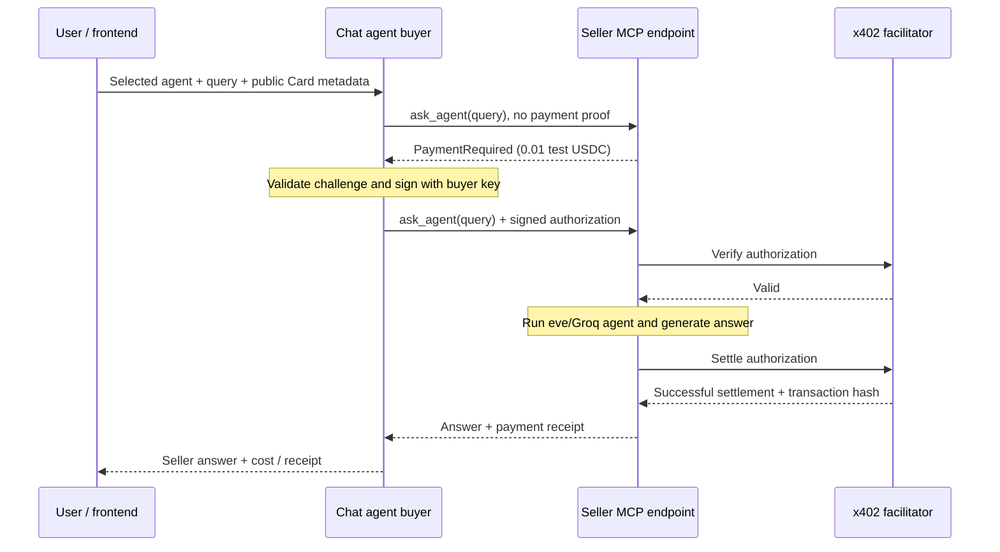

# Payments and agent access

Chat agent is the buyer: it uses the user's configured backend wallet to purchase an answer from Agentonchain assistant or Everyday helper. Those two agents are sellers. Each `ask_agent` call costs **0.01 test USDC on Base Sepolia**. Listing agents and ordinary Chat answers are free.

## Start all backend agents

From the repository root:

```sh
cd backend
nvm use
npm run dev:all
```

The launcher is `scripts/run-all-agents.mjs`. It loads the ignored `backend/.env.local` into all three processes, preserves environment variables already set in your shell, and runs each agent from its own folder. Logs share one terminal. Ctrl+C stops all three; if one exits unexpectedly, the others stop too. Occupied ports produce an error before any agents launch, so stop individual agent servers first.

Run the frontend separately with `npm run dev` in `frontend/`.

| Agent | Folder | Endpoint | Role |
| --- | --- | --- | --- |
| Agentonchain assistant | `backend/agent/` | `http://127.0.0.1:2000/mcp` | Paid seller |
| Everyday helper | `backend/everyday-helper/agent/` | `http://127.0.0.1:2001/mcp` | Paid seller |
| Chat agent | `backend/chat-agent/agent/` | `http://127.0.0.1:2002/eve/v1/session` | Free chat and payment buyer |

## Wallet setup

Set these in `backend/.env.local`, then restart the agents:

| Setting | Purpose |
| --- | --- |
| `GROQ_API_KEY` | Runs the agents' models. |
| `ACC_PRIVATE_KEY` | Buyer wallet key, used only by the backend to sign payment authorizations. |
| `X402_RECIPIENT` | Seller's receiving public address. Both sellers currently share this recipient. |
| `X402_MAX_PER_CALL_USDC` | Backend spending cap per call; defaults to `0.01`. |
| `X402_FACILITATOR_URL` | Verification and settlement service; defaults to `https://x402.org/facilitator`. |
| `GROQ_MODEL` | Optional model override; defaults to `openai/gpt-oss-20b`. |

The configured seller recipient is `0x1C4817CB230d8d3553459F6d57A11F8a8a7D5102`. It receives payment; it does not sign the buyer's payment. The buyer needs Base Sepolia test USDC. The network identifier is `eip155:84532`; the test USDC contract is `0x036CbD53842c5426634e7929541eC2318f3dCF7e`.

In frontend **Cards**, save the **buyer's public address**, matching the backend signer address shown on the page, with a limit of at least `0.01` USDC. Only one Card is supported. It contains public wallet metadata and a spending limit; the private key stays in `.env.local`. Card state currently clears on reload or sign-out. “Backend signer connected” means the Card address matches the configured key; it does not check the wallet's balance.

## What happens when you ask Chat to use an agent

Example:

> List the available agents.
>
> Use Everyday helper to answer “Who are you?”

1. Chat calls `list_agents` to read the backend registry. Endpoints are already known before payment; payment authorizes a query at an endpoint.
2. The frontend sends the user's message and saved Card to `/api/chat`. Its server proxy forwards public wallet metadata in `x-payment-wallet` to Chat's eve channel.
3. The channel validates the Card and places it in runtime auth attributes for that message. The model cannot set wallet addresses or spending limits through tool arguments.
4. Chat calls `invoke_paid_agent` with `agentId: "everyday-helper"` and the query. The backend resolves the seller's endpoint from the registry, checks the Card against the buyer key, and enforces the lower of the Card limit and backend cap.
5. The buyer's MCP client calls the seller's `ask_agent` tool without a payment proof. The seller returns an x402 payment challenge.
6. The buyer checks the challenge's recipient, price, token, network, payment scheme, and expiry. It signs a USDC payment authorization using `ACC_PRIVATE_KEY` and retries the tool call with that authorization.
7. The seller asks the facilitator to verify the authorization. Only after verification does the seller run its eve/Groq agent for the query.
8. If the agent produces an answer, the facilitator settles payment. The seller releases the answer with a payment receipt only after successful settlement.
9. Chat receives the answer, cost, and settlement transaction hash and uses them in its frontend response.



Signing is not a separate “send money, then obtain a URL” step. The signed authorization accompanies the MCP request; the facilitator settles it as part of the paid tool flow.

## Why MCP is used if the agent has an endpoint

**MCP is the request protocol used at that HTTP endpoint.** Calling Everyday helper through MCP means sending requests to `http://127.0.0.1:2001/mcp` using MCP's JSON-RPC format. MCP provides initialization, tool discovery, tool invocation, and structured results. The client SDK manages this protocol.

The tool call has this shape (the SDK handles initialization separately):

```json
{
  "jsonrpc": "2.0",
  "id": 2,
  "method": "tools/call",
  "params": {
    "name": "ask_agent",
    "arguments": { "query": "Who are you?" }
  }
}
```

An unpaid call returns an MCP error result containing x402 `PaymentRequired` in `structuredContent` and text content. Its HTTP status remains **200**, because the challenge is carried in the MCP result. The paid retry adds the signed payload under `params._meta["x402/payment"]`. A successful answer includes the settlement receipt under result `_meta["x402/payment-response"]`. The buyer SDK exposes it as `paymentResponse`.

The seller's ordinary `/eve/v1/session` HTTP route rejects direct requests with 401 so it cannot bypass payment. MCP tool discovery and `ping` remain free. Each paid query starts a fresh seller task; seller conversation history is not shared across calls.

This project uses eve custom HTTP channels, the standard MCP SDK, and official `@x402` packages. It adapts the Cloudflare payment example; it does not run Cloudflare `McpAgent` classes or Workers.

## Limits, receipts, and failures

- The price is exactly `10000` atomic USDC units, or `0.01` USDC. The buyer accepts only the configured recipient, Base Sepolia test USDC, x402 v2's exact scheme, and an authorization timeout of at most 120 seconds.
- Missing Cards, mismatched buyer addresses, and insufficient spending caps stop the request before signing. An unexpected seller challenge also prevents signing.
- An agent execution error does not settle payment. A settlement failure does not release a successful paid answer.
- The ledger in the Chat agent's ignored `.eve/paid-calls/` directory allows one paid attempt per turn. An identical completed call replay returns its cached answer and receipt; failed or uncertain attempts are not automatically paid again. Keep this directory across restarts.
- If the connection fails after signing, payment may already have been submitted. Check the wallet before explicitly retrying. Chat reports success only when it receives a confirmed receipt.
- This is a local demo with one configured backend buyer wallet. Distributed deployment needs shared durable payment state and real user authentication.

## Implementation map

| File | Responsibility |
| --- | --- |
| `payments/agent-registry.ts` | Agent IDs, known endpoints, prices, and roles. |
| `chat-agent/agent/tools/list_agents.ts` | Free agent listing. |
| `chat-agent/agent/tools/invoke_paid_agent.ts` | Model-facing paid delegation; reads wallet from trusted runtime context. |
| `chat-agent/agent/channels/eve.ts` | Receives and validates Card metadata per message. |
| `payments/paid-buyer.ts` | Buyer key, policy checks, MCP client, signing, and receipt handling. |
| `payments/paid-mcp.ts` | Seller MCP tool, payment wrapper, eve execution, and settlement gate. |
| `payments/payment-ledger.ts` | Local attempt reservations and completed-call caching. |
| `../frontend/src/app/api/chat/route.ts` | Frontend-to-Chat proxy and wallet header forwarding. |
| `../frontend/src/components/cards.tsx` | Public wallet Card and signer status. |

Payment tests use a synthetic key and mocked facilitator, including real signature verification. They do not establish live settlement. After startup, check `/eve/v1/health` on each agent's port to confirm server availability; this does not check wallet funding or establish a completed payment.
